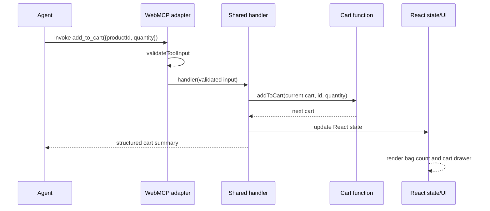

# 02 — Architecture

## Folders

- `completed/src/products.ts`: catalog, category list, search/filter and detail lookup.
- `completed/src/cart.ts`: pure cart operations and summary.
- `completed/src/tools.ts`: tool schemas, shared handlers and strict input validation.
- `completed/src/webmcp.ts`: capability detection and browser registration lifecycle.
- `completed/src/main.tsx`: React storefront and developer workbench.
- `starter/`: independently runnable React store without the WebMCP adapter or workbench.
- `agent/app.py`: Gradio chat loop, OpenAI Responses API function calls, and Playwright bridge to the Chrome page's WebMCP tools.
- `course-docs/`: teaching and recording notes.

## Data and state flow

```mermaid
flowchart LR
  UI[React storefront] --> Catalog[products.ts]
  UI --> Cart[cart.ts pure functions]
  Workbench[/dev-tools] --> Validate[tools.ts validation]
  Agent[Compatible browser agent] --> Browser[document.modelContext]
  Browser --> Adapter[webmcp.ts]
  Adapter --> Validate
  Validate --> Handlers[shared tool handlers]
  Handlers --> Catalog
  Handlers --> Cart
  Cart --> State[React cart state]
  State --> UI
  Chat[Gradio ChatInterface] --> OpenAI[OpenAI Responses API]
  OpenAI -->|function call| Python[agent/app.py]
  Python -->|Playwright CDP| Browser
```

Tool callbacks call the same pure catalog/cart functions used by the visible controls. A stable action object reads the latest cart through a ref and updates React state; this avoids closures holding old cart data while keeping the registration stable. Registration takes an `AbortSignal`; aborting it unregisters the tools when the component unmounts.

The optional Python agent reads only the six allowed tool definitions from the open SimpliShop page, gives their descriptions and schemas to the OpenAI API, and executes model-selected calls through that page's `document.modelContext.executeTool()`. The CDP connection controls a dedicated Chrome profile; it does not add an HTTP API to the store. Chat messages and tool results are sent to OpenAI; the API key stays in the Python agent's environment and is never passed to the browser page.


